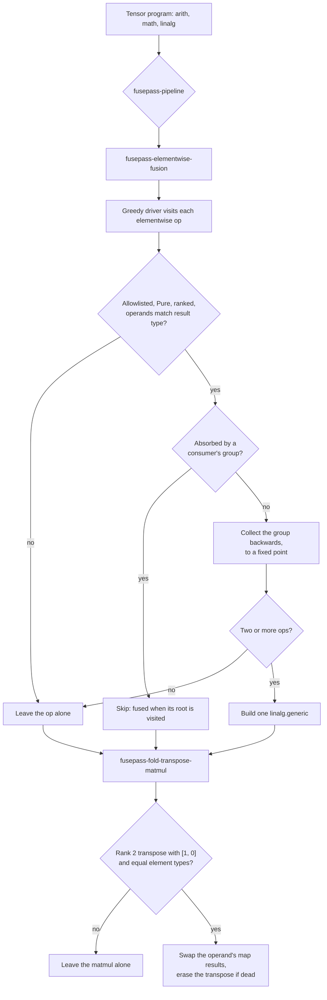

# FusePass

Two out-of-tree MLIR passes in C++, built with Clang and CMake against LLVM/MLIR
23.1.5:

- **`fusepass-elementwise-fusion`** fuses chains and small trees of elementwise
  tensor ops into one `linalg.generic`.
- **`fusepass-fold-transpose-matmul`** folds a rank 2 transpose into
  `linalg.matmul` by rewriting its indexing maps.

There is no custom dialect. Everything uses upstream `func`, `arith`, `math`,
`tensor` and `linalg` on ranked tensors. The tests use FileCheck under lit.

## Status

What has actually been run, and where:

| Item | Status |
|---|---|
| Both passes, driver `fusepass-opt`, lit suite on Windows 11 with MSYS2 CLANG64 and MLIR 23.1.5 | Run: 11 tests pass, 3 skip because the build lacks the feature |
| Debug text from `LLVM_DEBUG` | Seen through a throwaway copy with the gate removed, see [DEBUGGING.md](docs/DEBUGGING.md) |
| `--debug-only=fusepass` and `--mlir-pass-statistics` on an assertions build | **Not run.** Windows Smart App Control blocked the LLVM source build on the development machine |
| Plugin loaded into stock `mlir-opt` on Linux | **Not run yet.** CI has a step for it. The apt `mlir-opt` links `libMLIR.so`, which is what a plugin needs, but that is evidence rather than proof |
| GitHub Actions workflows | **Not run until the repository is pushed.** `ci.yml` runs on every push. `assertions.yml` is started by hand and covers the assertions build |

## Elementwise fusion

Input, from [`examples/fuse_chain.mlir`](examples/fuse_chain.mlir):

```mlir
func.func @scale_sum(%a: tensor<4xf32>, %b: tensor<4xf32>) -> tensor<4xf32> {
  %two = arith.constant dense<2.0> : tensor<4xf32>
  %sum = arith.addf %a, %b : tensor<4xf32>
  %abs = math.absf %sum : tensor<4xf32>
  %out = arith.mulf %abs, %two : tensor<4xf32>
  return %out : tensor<4xf32>
}
```

After `fusepass-opt examples/fuse_chain.mlir --fusepass-elementwise-fusion`:

```mlir
func.func @scale_sum(%arg0: tensor<4xf32>, %arg1: tensor<4xf32>) -> tensor<4xf32> {
  %0 = tensor.empty() : tensor<4xf32>
  %1 = linalg.generic {indexing_maps = [#map, #map, #map], iterator_types = ["parallel"]} ins(%arg0, %arg1 : tensor<4xf32>, tensor<4xf32>) outs(%0 : tensor<4xf32>) {
  ^bb0(%in: f32, %in_0: f32, %out: f32):
    %cst = arith.constant 2.000000e+00 : f32
    %2 = arith.addf %in, %in_0 : f32
    %3 = math.absf %2 : f32
    %4 = arith.mulf %3, %cst : f32
    linalg.yield %4 : f32
  } -> tensor<4xf32>
  return %1 : tensor<4xf32>
}
```

A value with two different users stays materialized, and this function comes out
unchanged:

```mlir
func.func @two_users(%arg0: tensor<4xf32>, %arg1: tensor<4xf32>) -> (tensor<4xf32>, tensor<4xf32>) {
  %0 = arith.addf %arg0, %arg1 : tensor<4xf32>
  %1 = arith.mulf %0, %arg0 : tensor<4xf32>
  %2 = arith.subf %0, %arg1 : tensor<4xf32>
  return %1, %2 : tensor<4xf32>, tensor<4xf32>
}
```

## Transpose into matmul

Input, from [`examples/fold_transpose.mlir`](examples/fold_transpose.mlir):

```mlir
func.func @transpose_a_times_b(%x: tensor<3x2xf32>, %y: tensor<3x4xf32>, %out: tensor<2x4xf32>) -> tensor<2x4xf32> {
  %init = tensor.empty() : tensor<2x3xf32>
  %t = linalg.transpose ins(%x : tensor<3x2xf32>) outs(%init : tensor<2x3xf32>) permutation = [1, 0]
  %r = linalg.matmul ins(%t, %y : tensor<2x3xf32>, tensor<3x4xf32>) outs(%out : tensor<2x4xf32>) -> tensor<2x4xf32>
  return %r : tensor<2x4xf32>
}
```

After `fusepass-opt examples/fold_transpose.mlir --fusepass-fold-transpose-matmul`:

```mlir
#map = affine_map<(d0, d1, d2) -> (d2, d0)>
#map1 = affine_map<(d0, d1, d2) -> (d2, d1)>
#map2 = affine_map<(d0, d1, d2) -> (d0, d1)>
func.func @transpose_a_times_b(%arg0: tensor<3x2xf32>, %arg1: tensor<3x4xf32>, %arg2: tensor<2x4xf32>) -> tensor<2x4xf32> {
  %0 = linalg.matmul indexing_maps = [#map, #map1, #map2] ins(%arg0, %arg1 : tensor<3x2xf32>, tensor<3x4xf32>) outs(%arg2 : tensor<2x4xf32>) -> tensor<2x4xf32>
  return %0 : tensor<2x4xf32>
}
```

MLIR 23 has no `linalg.matmul_transpose_a`, so `indexing_maps` is how this is
spelled. It also expresses a transpose on both operands at once.

## Pass flow



## Build and test

Details and every route are in [docs/BUILD_AND_TEST.md](docs/BUILD_AND_TEST.md). In
short, with Clang, CMake, Ninja, LLVM/MLIR 23 and lit installed:

```bash
cmake -G Ninja -S . -B build -DCMAKE_BUILD_TYPE=Release \
  -DCMAKE_C_COMPILER=clang -DCMAKE_CXX_COMPILER=clang++ \
  -DMLIR_DIR=/path/to/lib/cmake/mlir -DFUSEPASS_LIT="$(command -v lit)"
```

```bash
cmake --build build --target check-fusepass
```

The real result of that target on the development machine:

```text
lit: note: plugin unavailable, using the fusepass-opt driver
lit: note: pass statistics recorded: False
lit: note: llvm-config --assertion-mode: OFF
Total Discovered Tests: 14
  Unsupported:  3 (21.43%)
  Passed     : 11 (78.57%)
```

Entry points:

- `mlir-opt --load-pass-plugin=build/lib/FusePassPlugin.so ...` is the plugin. It
  needs a platform where `mlir-opt` can share MLIR with the plugin.
- `fusepass-opt ...` is a small driver on `MlirOptMain` with the same command line.
  Windows needs it, because the stock `mlir-opt.exe` links MLIR statically.

The test suite chooses between them by running the tool, so every RUN line goes
through the plugin wherever that works.

## Seeing what the passes decided

`--mlir-pass-statistics` and `--debug-only=fusepass` both need an LLVM with
assertions. The `emit-remarks` option works on any build. Real output:

```text
$ fusepass-opt examples/fuse_chain.mlir -o /dev/null --mlir-disable-threading \
    --pass-pipeline='builtin.module(func.func(fusepass-elementwise-fusion{emit-remarks=true}))'
examples/fuse_chain.mlir:9:10: remark: fused group of 3 ops
examples/fuse_chain.mlir:16:10: remark: fused group of 2 ops
examples/fuse_chain.mlir:24:8: remark: not fused: group has only one op
examples/fuse_chain.mlir:23:8: remark: not fused: group has only one op
examples/fuse_chain.mlir:22:8: remark: not fused: group has only one op
```

The passes declare these statistics, and `test/debug/statistics.mlir` checks them on
builds that record statistics. That test has not run yet, so no sample output is
shown here.

| Pass | Statistic | Meaning |
|---|---|---|
| Fusion | `fused-groups` | Groups rewritten into one `linalg.generic` |
| Fusion | `fused-ops` | Ops moved into a `linalg.generic` |
| Fusion | `rejected-candidates` | Elementwise tensor ops left unfused at a group root |
| Fold | `transposes-folded` | Matmul operands that now read past a transpose |

## Limitations

- Only `arith` and `math` ops on tensors, from a fixed allowlist.
- No broadcasting: every op in a group has the same tensor type.
- Identity indexing maps only, and only all-parallel iterators.
- No fusion into reductions, `linalg.matmul` or other consumers that are not on the
  allowlist.
- No `memref` support and no custom dialect.
- The transpose fold looks only at a transpose directly on the operand, and only at
  `linalg.matmul`.
- The driver removes unused ops, so dead code disappears even where nothing fused.
- **No performance claims.** Nothing here has been measured, and fusing does not by
  itself make a program faster.

## Future work

- Run the two GitHub Actions workflows, which close the gaps listed under Status.
- An end-to-end test that lowers fused and unfused versions and compares numbers.
  It was skipped because Smart App Control also blocked `mlir-runner.exe` on the
  development machine.
- More ops on the allowlist, such as `arith.select`, whose operand types differ.

## More

- [docs/DESIGN.md](docs/DESIGN.md): legality rules, design choices and an honest
  comparison with upstream.
- [docs/DEBUGGING.md](docs/DEBUGGING.md): the mutation check and real failures.
- [CONTRIBUTING.md](CONTRIBUTING.md)

MIT licensed. See [LICENSE](LICENSE).
